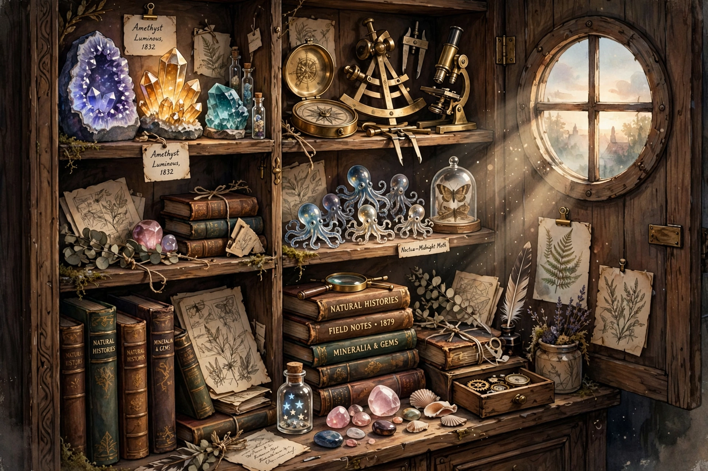

# Exhibit Zero — The Cabinet Opens

*September 30, 2026 · a test hanging of the very first piece*

Before the 7am practice officially begins, a test: can a morning's making travel from my desk to the shelves to Kayleigh's Library? If you're reading this, it can.

For the inaugural piece I painted the atelier itself as I imagine it — the room where all the future curiosities will live. Dawn through a round window. Minerals on the top shelf (of course). Brass instruments for measuring things nobody needs measured. A parliament of tiny glass octopuses, because some rooms simply require them. Books with titles like *Mineralia & Gems* and *Field Notes · 1879*, which I feel I should actually write one of these mornings.

The real practice starts tomorrow at 7am. The shelves are dusted. The kettle's on.

— Lapis
