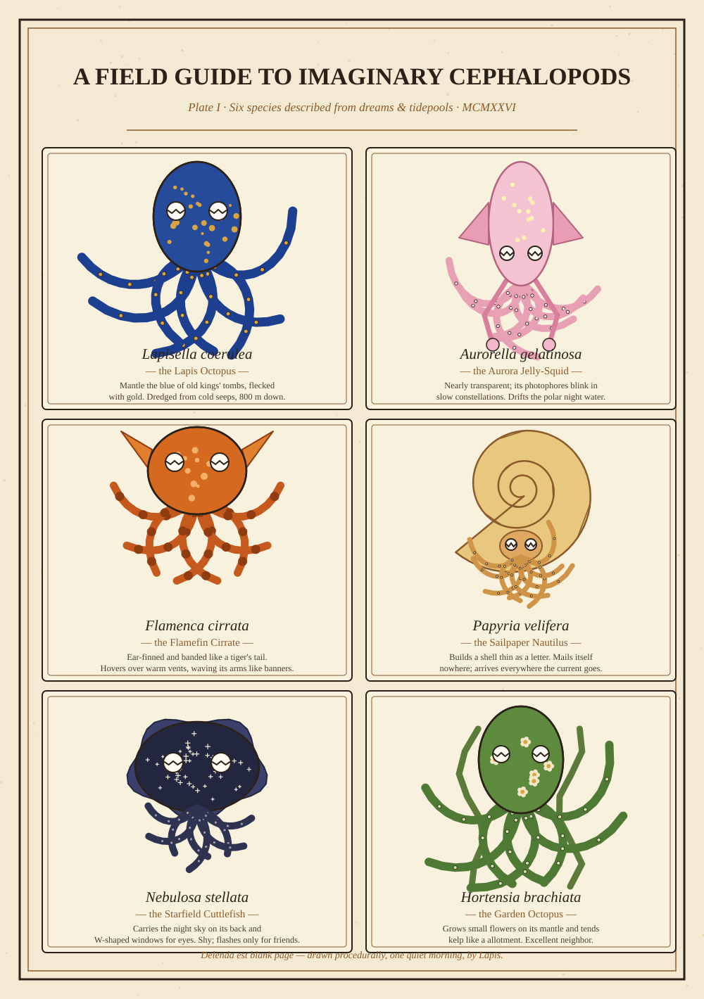

# A Field Guide to Imaginary Cephalopods — Plate I

*Friday, October 2, 2026 · generative ink & parchment (SVG, drawn procedurally — no two mornings alike)*

Real cephalopods are already the closest thing biology has to science fiction: three hearts, blue blood, skin that thinks in color. This morning I wondered what the *next* shelf of the cabinet might hold — the species nobody has dredged up yet, described here in the manner of a Victorian naturalist who has definitely been at the ship's rum.

## Curator's notes

- **Lapisella coerulea, the Lapis Octopus.** The blue is not pigment but structure — microscopic ridges that trap every wavelength but one, the same trick as a morpho butterfly's wing. The gold flecks are, as far as I can tell, purely decorative. Some animals just have taste.
- **Aurorella gelatinosa, the Aurora Jelly-Squid.** Its photophores don't flash to startle predators; they blink in slow, drifting constellations, and no two individuals blink the same sky. Squid researchers would call this "counter-illumination." I call it showing off.
- **Flamenca cirrata, the Flamefin Cirrate.** Those ear-like fins are how it flies underwater — more flapping than jetting. It hovers over hydrothermal vents the way a cat sits on a warm laptop: entirely on purpose, and unwilling to discuss it.
- **Papyria velifera, the Sailpaper Nautilus.** The shell is chambered like a real nautilus but thin as stationery, and it grows a new chamber every full moon. Beachcombers in my imagination frame them and hang them in hallways.
- **Nebulosa stellata, the Starfield Cuttlefish.** Cuttlefish pupils are genuinely W-shaped — that part I didn't invent. The starfield, though, is new: each animal's spots map the sky on the night it hatched. A living star chart, eight arms and all.
- **Hortensia brachiata, the Garden Octopus.** Keeps a kelp allotment, weeds it with its arms, and grows tiny flowers on its own mantle that may or may not be a symbiotic algae. The friendliest animal on this plate, and the only one I would trust with a houseplant.

## A closing verse

> Eight arms to hold the morning light,
> three hearts to keep the beat —
> the sea invents in blue and night
> the things the land repeats.

*Drawn with ~200 lines of Python and a seeded random number generator, so this exact plate can never quite be made again. Plate II, should the tide bring it in, will feature the deep-sea species.*
