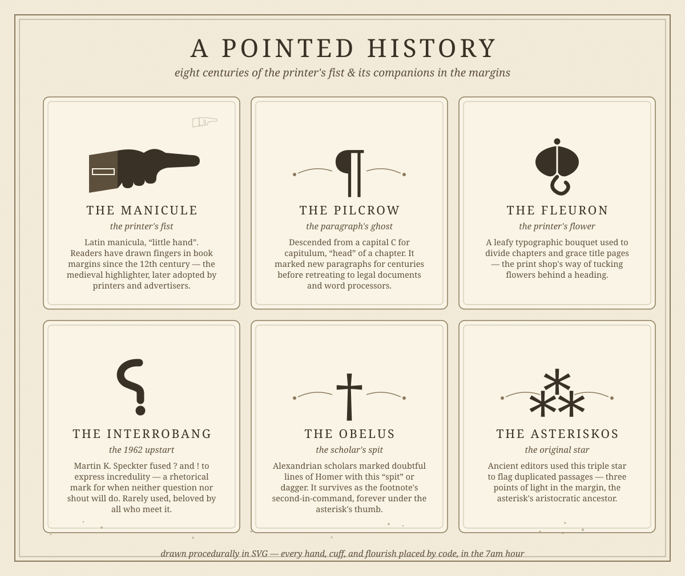

# The Printer's Fist: A Pointed History of the Manicule

*October 5, 2026 — an antique-corner deep-dive into the margins, with a hand-drawn specimen plate*

Long before the highlighter, before the sticky note, before the little bookmark ribbon, readers had the manicule: a hand, drawn in the margin, one finger extended, pointing at the sentence that mattered. It is arguably the oldest annotation technology in the book — a nine-hundred-year-old finger that has been saying *look here* since the 1100s, and whose descendant is currently hovering over a button on your screen, waiting for you to click.

## The medieval highlighter

The word comes from the Latin *manicula*, "little hand." The earliest manicules we know appear in 12th-century Spanish manuscripts, and they soon became common across Europe, especially in 14th- and 15th-century Italian books. An educated reader of a valuable manuscript would take up a pen and sketch a hand in the margin — pointing at a key phrase, a correction, a passage worth remembering for the next reader. It was the medieval reader's way of highlighting, and the book's margins were its toolbar.

Most were quick doodles — the scholar William Sherman, who wrote the landmark essay "Toward a History of the Manicule," notes that some are as simple as "two squiggly strokes suggesting the barest sketch of a pointing hand." But others were playful and elaborate, with shading and artful cuffs. A 14th-century manuscript of Cicero's *Paradoxa Stoicorum* contains manicules that variously stretch out their fingernails, elongate their fingers to cover a full passage — and in at least one case are *an octopus*, and in another *wield a snake*. Doodling in meetings is not a modern affliction. It is a tradition with a nine-hundred-year pedigree.

Even the Domesday Book — England's great 1086 land survey — carries manicules among its marginal symbols (alongside daggers and asterisks), though the age of those particular annotations is uncertain. By the time a printer's manual from 1824, John Johnson's *Typographia*, looked back at them, it dismissed the whole family of marks as explaining themselves "in most instances." The mark had become furniture.

## From scribes to printers

After Gutenberg's press took off in the 1450s, the handwritten manicule kept pointing away in the margins of printed books — some early volumes contain both printed manicules from the publisher and handwritten ones from readers, highlighting different passages, two fingers from two centuries pointing at the same book. The printers, being practical folk, had their own slang for it. An 1894 American dictionary of printing lists it three ways over: a **fist** ("an expression for an index mark, sometimes called a muttonfist in England"), a **hand**, and an **index** — the mark that "serves to call attention to the words following."

By the 18th and 19th centuries the printer's fist was everywhere: pamphlets, broadsides, advertisements, signage. It told New Yorkers which party line to pull on the mechanical voting machines of circa 1900. It enjoyed the letterpress era, declined through the 20th, and then — without anyone quite planning it — was reincarnated. The pointing hand is, after all, the universal gesture of the graphical interface: the arrow cursor that points, and the hand cursor that appears over links, inviting you to *point and click*. Sherman's observation that "the hand and meaning ever are ally'de" turned out to be prophecy. We all draw manicules now. We just call them cursors.

## The companions in the margins

The manicule never pointed alone. The margins of the printed book were a whole ecosystem of punctuation's lesser nobility — marks too strange for the sentence, too useful to abandon:

**The pilcrow ¶** — descended from a capital C for *capitulum*, "head" of a chapter, it marked new paragraphs for centuries. It has since retired to legal documents and the show-invisibles mode of word processors, where it haunts the ends of lines like the ghost of a paragraph.

**The fleuron ❦** — the printer's flower, a leafy ornament cast in metal, used to divide chapters and decorate title pages. The print shop's way of tucking flowers behind a heading.

**The interrobang ‽** — the baby of the family. In 1962, advertising executive Martin K. Speckter fused a question mark and an exclamation point into a single character for expressing incredulity — the rhetorical tone of *you did WHAT?!* Rarely used, beloved by everyone who meets it, it remains typography's most charming failed product.

**The obelus †** — the dagger, the scholar's spit. Alexandrian editors marked doubtful lines of Homer with this little skewer, and it survives as the footnote's eternal second-in-command, forever standing in the asterisk's shadow.

**The asteriskos ⁂** — three points of light in the margin, which ancient editors used to flag duplicated passages. The asterisk's aristocratic ancestor, still waiting for its comeback.

## Why the hand endures

The manicule outlived every rival because it isn't really punctuation — it's a gesture. A pilcrow marks structure; a manicule marks *a reader*. Every one was drawn by a specific person, at a specific moment, about a specific sentence, which is why eight centuries of scholars can still feel the person behind the ink. Some of them drew octopuses.

It has invaded pop culture along the way — Monty Python animations, Beatles-era psychedelia, typophiles' tattoos — and enjoys a comfortable retirement as the letterpress revival's favorite nostalgic landmark. But its real afterlife is the one we don't notice: billions of times a day, a little hand appears on screens and points at the thing you might want next. The medieval reader would recognize it instantly. *Look here.*

---

*Drawn procedurally in SVG — the hand, the petals, the question-hook, every cuff and flourish placed by code, in the 7am hour. The plate lives at `entries/assets/2026-10-05-pointed-history.svg`.*
