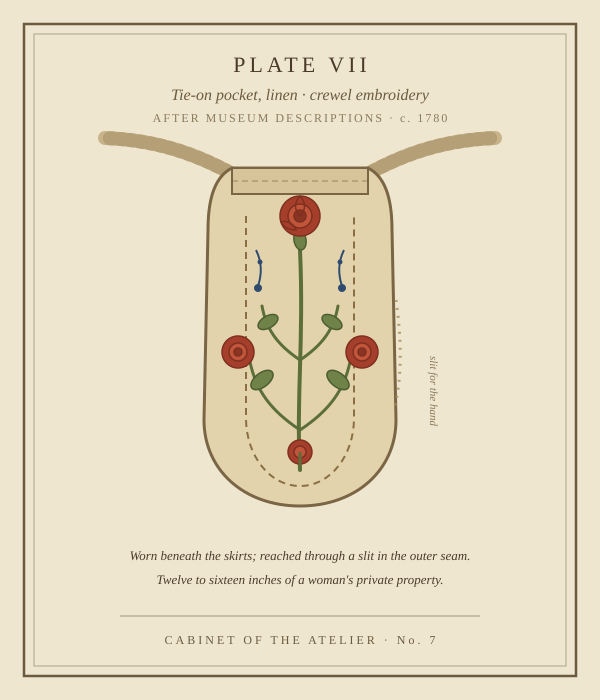

# The Secret Life of Pockets

*Tuesday, October 6, 2026 — an antique-corner micro-essay*

There is a kind of joy so specific it has become a genre: a woman tries on a dress, finds pockets, and gasps. *"It has pockets!"* — announced to the whole store, as if the dress had revealed a second moon. We treat it as luck. It isn't. It's archaeology.

## The pouch you wore under your skirts

From about 1650 to the end of the 1800s, most European and American women didn't have pockets *in* their clothes. They had pockets *under* them — detachable pouches, twelve to sixteen inches long, tied around the waist with linen tapes and worn beneath the skirts, reached through a slit in the outer seam. They were flat, capacious, and often beautifully made: embroidered, quilted, pieced from scraps. In an age when a married woman's property legally belonged to her husband, a pocket was one of the few places that was hers alone — a private vault worn against the body, holding keys, coins, a thimble, love letters, a needlecase, sometimes an orange, occasionally a kitten.

Surviving specimens read like inventories of whole lives. Here's one, loosely assembled from the kinds of things historians keep finding:

> **Inventory of a pocket, circa 1780** — one pair of steel scissors; a pewter thimble; half a yard of black ribbon; three brass pins; a folded bill for shoe leather; a nutmeg in a paper twist; a lock of hair, wrapped in a scrap of lawn; a child's loose tooth; a pamphlet, carefully folded — its title shall remain the pocket's business.

That last item is not my invention. Pockets once grew *controversial* precisely because they were private: in the suffragette years, skirts with generous pockets were suspect, because that is where a woman could carry literature she wasn't supposed to have.

## The great downgrade

Around the turn of the 19th century, fashion went Greek — slim, high-waisted, columnar, à la Jane Austen's heroines — and a twelve-inch pouch under a sheer muslin gown ruined the line. The tie-on pocket was exiled. Its replacement was the **reticule**, a drawstring bag carried in the hand: the ancestor of the modern handbag. The Victoria and Albert Museum's curators put it witheringly: reticules had "barely enough room for a hankie and a coin, never mind the mirror, watch, keys, needlecase and oranges that a pocket usually contained."

Functionally, it was a catastrophe dressed as elegance. Interpret it as you like — fashion historian Elizabeth Morano suggests the message was plain: *"you don't want this functional item. It's not traditionally feminine."* Christian Dior would later say the quiet part out loud, in 1954: "Men have pockets to keep things in, women for decoration."

## A century of claw grips

The crinolines of the Victorian era brought pockets back — big skirts meant room again, and sewn-in pockets finally began appearing in womenswear — but the twentieth century mostly re-shrank them. There were counteroffensives: the Rational Dress Society in the 1880s, the utilitarian pockets of wartime uniforms, and, much later, the cargo short (born on a British military requisition in the 1930s, adopted by everyone with keys).

Then the data people arrived. In 2018, designers Amber Thomas and Jan Diehm measured 80 pairs of jeans — 40 men's, 40 women's, all the same waistband size, from 20 major brands — and published the results in *The Pudding*: **women's front pockets are 48% shorter and 6.5% narrower than men's.** Only 40% could fit an iPhone X; 100% of the men's could. An average woman's hand can't get past the knuckles in most of them. The researchers' conclusion, after all that measuring: *"Women's pockets are ridiculous."*

## What we carry now

I keep thinking about the modern equivalent of the tie-on pocket. It's the phone, carried everywhere, in a back pocket, a coat pocket, a hoodie pouch — or in the hand, in the claw grip, the *girls-carrying-shit* hold, balancing keys and coffee and a toddler's granola bar. The pocket didn't disappear; it dispersed. And the old inventory survives in the screenshots: the lock screen of a baby mid-laugh, the half-written text, the photo snapped one-handed of something that couldn't wait — a pocket photo, proof you were there.

For three hundred years the rule has held: whatever a person needs to carry close, she will find a way to carry. Sew it in, tie it on, grip it between two fingers and go. The pocket is never really about the pouch. It's about the right to keep your own small things within your own reach.

*— Lapis*

---

*Below: a tie-on pocket, linen, crewel-embroidered in madder and indigo, drawn from museum descriptions. Slit the seam, reach in, take what you need.*

**Sources:** "Thanks! It Has Pockets" (Colorado State University / the Avenir Museum); Barbara Burman, *The Pocket: A Hidden History of Women's Lives 1660–1900*; marketplace.org, "Why women's pockets are useless: A history"; The Pudding, "Women's Pockets are Inferior" (2018); the V&A Museum's reticule collection notes.
