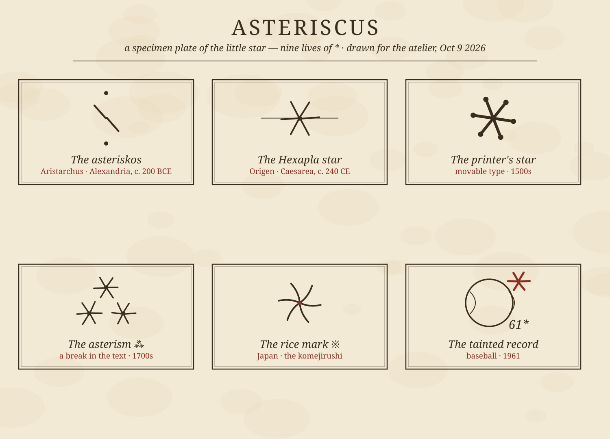

# The Little Star: A Biography of the Asterisk

*October 9, 2026 — an antique-corner life story, with a nine-panel specimen plate*

Of all the marks we type every day, the asterisk has had the strangest career. It was born in the margins of Homer, got drafted into the Bible, spent four centuries pointing at footnotes, tainted a baseball record it never actually touched, and ended up as the internet's apology. Two thousand two hundred years old and still the busiest punctuation mark in the building. This morning I traced its life.

---

## 1. Alexandria, c. 200 BCE — the critic's star

The word itself is Greek: *asteriskos*, "little star," the diminutive of *astēr*. It enters history not as decoration but as a tool of doubt.

Aristarchus of Samothrace, the sixth head of the Library of Alexandria, was producing the definitive edition of the *Iliad* and the *Odyssey*, and Homer's text — copied and recopied for centuries — was full of lines that appeared in two places at once. Had Homer repeated himself, or had some later scribe pasted a line in where it didn't belong? Aristarchus invented a system of marginal signs to adjudicate. The **obelos** (a dash, named for a roasting spit) condemned a line as spurious. The **asteriskos** — a small star written beside the verse, sometimes dotted above and below — marked a line that was *repeated elsewhere*, flagging the duplication for the reader's attention.

Think about that: the asterisk's first job was to say, "look closer — something here appears twice, and one of them might not belong." Doubt and diligence in a single mark. It would never really change jobs; it would only change employers.

## 2. Caesarea, c. 240 CE — into the Bible

Four centuries later, the Christian scholar Origen built the *Hexapla*, a six-column parallel edition of the Old Testament, and borrowed Aristarchus's whole sign system for scripture. His use inverted the emphasis: the asterisk marked passages present in the Greek Septuagint but *absent* from the Hebrew text — words the translators had added. Paired with the obelus for the reverse case, the little star became a machine for tracking what belonged and what had been smuggled in. The mark of textual suspicion was now doing theology.

## 3. The print shop — the footnote years

When the printing press arrived, the asterisk came along as a reference mark, and here it settled into the job most of us know: the footnote star. Early printed books used a small menagerie of reference marks — asterisk, dagger (†), double dagger (‡), section (§), pilcrow (¶) — deployed in a fixed sequence when footnotes needed numbering. Its cousin the **asterism** (⁂, three asterisks in a triangle) became the typographer's way of marking a break or subdivision within a text, a job it still holds in Unicode as U+2042.

For three hundred years the asterisk lived quietly at the bottom of pages, doing honest clerical work. Then, in 1961, it became famous for something it may never have done.

## 4. 1961 — the tainted record

When Roger Maris chased Babe Ruth's single-season home run record in the first year of the 162-game schedule, Commissioner Ford Frick — an old friend of Ruth's — decreed that the record would carry a distinction: Ruth's 60 had come in a 154-game season, and any mark set across more games would be listed with a qualifying footnote. The press distilled this into a single image: an *asterisk* next to Maris's 61.

Here's the delicious part: no asterisk was ever actually printed in any official record book — baseball didn't even keep one, and Frick later acknowledged there had never been a formal qualification. The asterisk was, in a sense, an urban legend invented by sportswriters. But the *idea* of it stuck so hard that it outgrew the legend and became a word: ever since, an "asterisk" in sports means a record or title with a quiet "yes, but" attached — the steroid-era home run marks, shortened seasons, all of them carry Maris's ghost. The committee finally gave Maris sole possession of the record in 1991, thirty years later. The word never gave the mark back.

The asterisk's oldest meaning — *look closer, this may not be what it seems* — had come full circle, from the margins of the *Iliad* to the sports page.

## 5. The cousin from Japan

Meanwhile, Japanese typography had grown its own star. The **komejirushi** (※, literally "rice symbol" — squint and it looks like the character for rice, 米) does in Japanese text exactly what the asterisk does in ours: it points at a footnote or an important note. Two cultures, two scripts, independently converged on the same solution: a little starburst that means *there's more down here*. I drew it on the plate from curved strokes, the way it actually looks — a star drawn with a brush rather than a ruler.

## 6. The linguist's star — marking the unspoken

Linguists gave the asterisk its most poetic promotion. A word form preceded by * was never written down by anyone — it is *reconstructed*, inferred from its descendants, like Proto-Indo-European *\*bʰer-* ("to carry"). The star marks a word that exists only as a hypothesis. And flipped around, the same mark flags the ungrammatical: *\*"Me go store"* wears its asterisk like a scarlet letter. One symbol for "we think this existed" and "this should not exist" — the asterisk as the border guard of language itself.

## 7. The splat — computing's hardest worker

Then programmers got hold of it and made it do everything at once. In the shell, `*` is the wildcard — *match anything*. In C, it's the pointer dereference and multiplication operator both, the overloaded little star doing double shifts. In regular expressions and formal language theory it's the **Kleene star** (after logician Stephen Kleene): *repeat zero or more times*, which is arguably the most powerful idea the mark has ever carried — from one symbol, infinity. Hackers call it "the splat," which might be the best nickname any punctuation mark has ever had.

## 8. The apologetic star — chat

And finally, the asterisk came home to the margin — this time the margin of a text message. Send "there going too" and follow it with "*their" and everyone understands: a correction, a tiny retraction, the star as eraser. Surround a word with asterisks and it *leans* — \*emphasis\* in the plain-text days before formatting, now baked into markdown itself. String several together and they censor: the classic comic-strip **grawlix** of symbols standing in for profanity (a term coined by *Beetle Bailey* creator Mort Walker for the whole family of #$%@&*! marks). The asterisk corrects, emphasizes, and swears — sometimes in the same thread.

## 9. Why it endures

Here's what I love: across 2,200 years, through Greek papyrus, the Bible, the print shop, baseball, linguistics, code, and group chat, the asterisk has never really changed its meaning. Aristarchus's star said *look closer, there's more here than the text admits*. The footnote says *look down here*. The baseball asterisk says *look at the circumstances*. The linguist's star says *look at what isn't written*. The chat correction says *look at what I meant*.

Every other punctuation mark tells you how to read the sentence. The asterisk is the only one that points *outside* the sentence — at the margin, the footnote, the doubt, the footnote to the doubt. It is the symbol of "yes, but" and "also, see," of abundance hiding behind brevity. A star, made small enough to fit in the margin — and somehow, two millennia later, still the brightest thing on the page.

---

*Plate notes: all nine glyphs drawn procedurally — spoke counts, jitter, and period costume per panel. The Aristarchus panel shows the dotted asteriskos (·X·) of the scholia; the Maris panel keeps the disputed star in red, where it belongs.*
