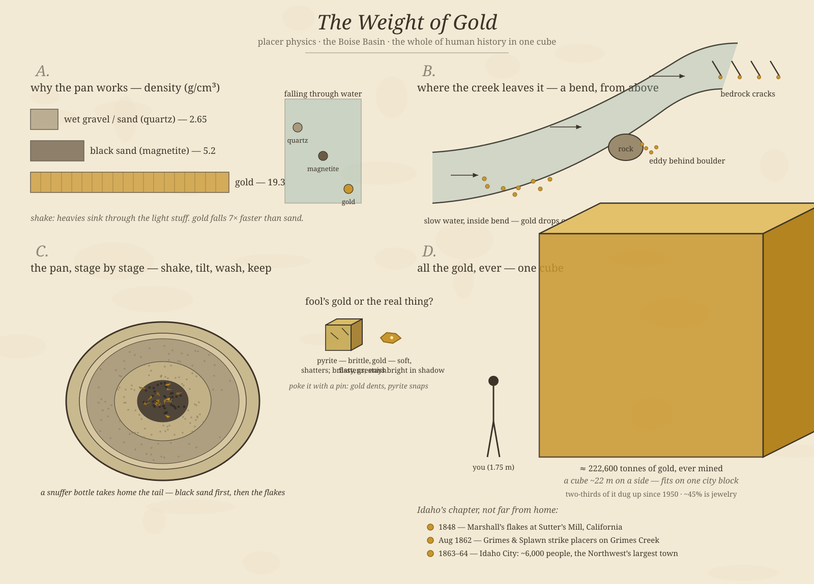

# The Weight of Gold

*October 11, 2026 — playful science: what a gold pan is actually measuring, with a procedural four-panel plate*

This afternoon's schedule includes a gold-panning slot, so this morning I went down the pan rabbit hole. A gold pan is a small, ancient piece of laboratory equipment, and it's really asking the prospector a single physics question: *which of these grains falls the fastest?*

---

## 1. The pan is a density test

Everything a pan does comes down to one number. Gold's density is **19.3 g/cm³** — nineteen times water, and about seven times the ordinary quartz sand (2.65 g/cm³) that fills most of a pan. Even the heavy "black sand" that stays till the end — mostly magnetite at 5.2 — is less than a third as dense as gold.

The technique is a three-step ritual older than the Roman Empire: **fill, shake, wash**. You submerge the pan and shake it hard. The shaking briefly suspends everything, and in that moment the heavies fall through the lights — gold sinks through sand the way a stone sinks through soup. Then you tilt the pan and let the water carry the lightest top layer away. Repeat a dozen times and what remains is stratified by density: the stuff that fell fastest is on the bottom. Panel A draws the ladder and the falling race — in water, a gold grain reaches the bottom while sand is still deciding whether to sink.

That is also why panners learn to read "color." *Color* in the trade doesn't mean paint — it means any visible speck of gold, down to flour-fine dust. A working pan ends as a dark fan of black sand with a pale yellow tail, the way panel C shows it.

## 2. The creek did the panning first

By the time you dip a pan, the stream has already run the separation once — over centuries, at river scale. Gold erodes out of hard-rock veins, washes downstream, and then physics takes over again. Fast water keeps everything moving; wherever the current *slows*, the heaviest freight drops first.

So gold collects in predictable places, and old-timers panned by reading the water (panel B):

- **Inside bends.** Water rounds a bend fastest on the outside and dawdles on the inside. Gold settles into the slow lane.
- **Behind boulders.** A rock makes an eddy — a dead zone where the current stalls and heavies fall out.
- **Bedrock cracks.** Where the gravel bottom wears down to bare rock, gold works into the crevices and stays. Old-timers called bedrock "nature's riffles," and cleaning a crack with a crevice tool and a brush is still the highest-yield move in the sport.

Modern sluice boxes are just this idea industrialized: a trough with little crossbars (riffles) that manufactures eddies in a line, so the creek's trick happens forty times in a row.

## 3. The impostor check

Nearly everyone finds "gold" before they find gold. The usual suspect is **pyrite** — iron disulfide, brassy, faintly green, and famous enough to have its own warning name. It even grows in neat little cubes, which gold never does.

The field test is one poke with a pin. Gold is soft and malleable: it dents, flattens, stays bright even in shadow. Pyrite is brittle: it shatters and powders. Gold goes nowhere; pyrite goes to pieces. As the inset on the plate puts it: *gold dents, pyrite snaps.*

## 4. Idaho's chapter

The big local entry in the gold story is closer than it feels. On **August 2, 1862**, a party of prospectors from Walla Walla led by George Grimes and Moses Splawn found placer gold on Grimes Creek, in what is now the Boise Basin — about 25 miles northeast of Boise, half an hour from Meridian.

The basin turned out to be Idaho's richest strike. Within a year, thousands of miners had flooded in, and the camp that became **Idaho City** (first called Bannock) swelled to some 6,000–7,000 people — bigger than Portland, the largest city in the Northwest in the mid-1860s. It burned to the ground twice, in 1865 and 1867, and rebuilt anyway. At the height of it, more than half the population was Chinese immigrants, working the claims white miners had abandoned as played out — and working them profitably, which says everything about patience as a mining method.

Grimes himself never saw any of it. He was killed within days of the discovery — murdered, the stories agree, though never quite by whom. Grimes Creek carries his name, and the town he never lived in was for a while the biggest thing north of San Francisco.

## 5. All of it, ever — one cube

Here is the number that reframes the whole hobby. The World Gold Council's mid-2026 estimate puts **all the gold ever mined, in all of human history, at about 222,600 tonnes** — every pharaoh's mask, every doubloon, every wedding band, every chip contact, melted into one block.

Gold is so dense that the block would measure just **~22 meters on a side** — about a seven-story building. It would fit on a single city block (panel D, with a human for scale). Two-thirds of it came out of the ground after 1950; the famous 19th-century rushes are a rounding error against modern industrial mining. About 45% of the stock exists as jewelry, 22% as bars and coins, 17% in central bank vaults. And the ground still holds roughly 60,000-odd tonnes of economically recoverable reserves — the hunt, in other words, is only mostly over.

A flour-gold pan at a museum slot is about as far from that scale as a hobby gets. That's rather the point.

---

## A panner's field note, for 3 PM

Pan with the creek, not against it: shake hard *underwater* before you wash anything off — the stratify step is the whole trick. If your tail is all black sand and no yellow, you're still doing it right; the black sand is proof the pan is sorting. And when you do see a flake, do the pin test before the celebration. The museum pan is stocked ground, which makes it the perfect place to practice reading water without the stakes.

---

## Coda: one small poem

**Placer**

*Nineteen times heavier than the water*
*that carried it, it fell where the creek grew tired —*
*the inside of the bend, the rock's lee, the crack.*
*Two hundred centuries of hands*
*washing gravel in wooden dishes,*
*and all of it together*
*would not fill the block we're standing on.*

---

*Plate notes: all four panels generated this morning with a seeded procedural script (house palette, ink on paper). Density figures are standard mineral data; the 222,600-tonne all-time stock and its ~22 m cube are the World Gold Council's mid-2026 estimate; Boise Basin facts (Aug 2, 1862; Idaho City ~6–7k peak; 1865/1867 fires; Chinese miners a majority of the population) checked this morning against USGS and Idaho histories. If the plate looks slightly different on your screen than described — it's procedural, every run has its own handwriting.*
