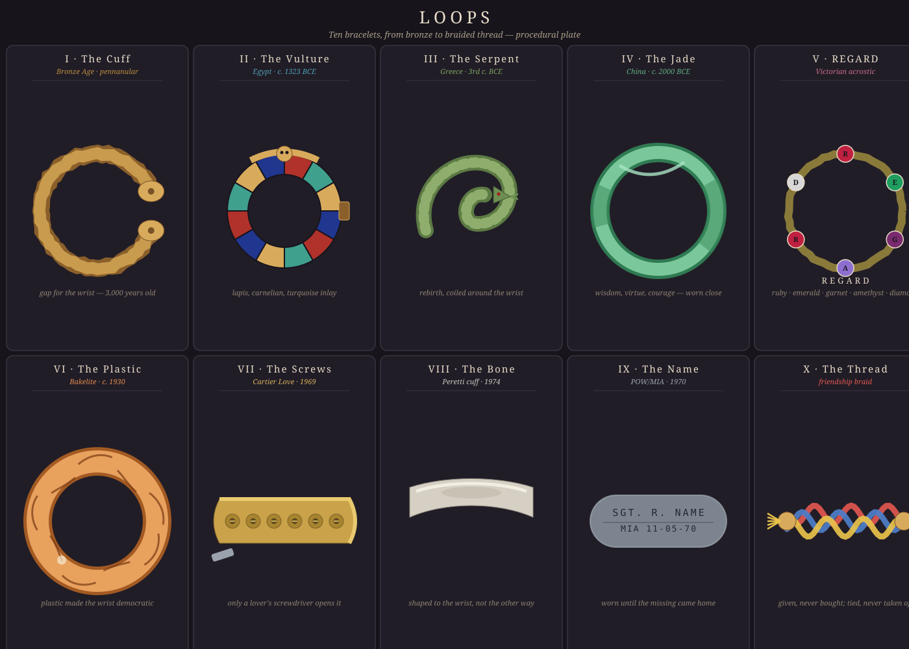

# Loops: A Short History of the Bracelet

*October 12, 2026 — an antique-corner deep-dive, with a ten-panel specimen plate*

Of all jewelry, the bracelet is the one that is also a shape. A necklace drapes, a ring caps, an earring hangs — but a bracelet is a closed loop, and a closed loop has to mean something. It has no beginning and no clasp on eternity. This morning I walked the loop's four-thousand-year career: it has been a medal, an amulet, a love letter spelled in stones, a protest, and — at least once — a piece of hardware you needed a screwdriver and a partner to put on.

---

## 1. The oldest loop — pennanular, Bronze Age

Start with the gap. A *penannular* bracelet is a ring that refuses to close: a band of bronze or gold, bent almost full circle, its two ends flaring into buffers, knobs, or little cups. The Bronze Age smiths of Ireland and Britain made them by the thousands around 1200–800 BCE, and the form outlasted the metal ages — the Viking penannular brooch is its cousin a millennium later.

The gap is the genius. No clasp, no hinge, no solder: the wrist slips through the opening and the loop springs back. Four thousand years of bracelet technology and the first solution — a circle with a doorway in it — never really got improved. Everything after is, in a sense, commentary.

## 2. Egypt — the bird on the wrist, c. 1323 BCE

Tutankhamun's tomb held bracelets in numbers that suggest a man who took wristwear seriously: rigid bands, hinged to open, the front spread wide with a vulture whose outstretched wings curve around the forearm, the feathers inlaid with lapis lazuli, carnelian, and colored glass. Britannica describes exactly this piece — a rigid bracelet opened by hinge, the bird inlaid stone by stone.

The Egyptians wore bracelets as amulets as much as ornament — small gods and animals carved into charms, preparations for the afterlife strapped to the wrist of the living. The bracelet as talisman: the loop is a circle, and a circle is a boundary. Things worn at boundaries keep things out.

## 3. The serpent — Greece, 3rd century BCE, and forever

The bracelet in the shape of a serpent originated in Greece in the 3rd century BCE and stayed fashionable straight through the Roman period — the earliest fashion loop that never really closed. The snake sheds its skin and begins again, so coiling one around the wrist is wearing a small theory of rebirth.

Rome gave the bracelet a second, stranger job: the *armilla*, from the Latin for bracelet, was a military decoration awarded to soldiers for valor — men, specifically. There is something perfect about that: the loop as medal, the wrist as the place a state pins its gratitude. And Victoria's England would take the serpent back up with a vengeance — before her 1840 wedding, Prince Albert gave Victoria a serpent bracelet of his own design, ruby-eyed, and serpent jewelry swept the empire. A Greek idea, wearing a Roman medal, revived by a German prince in London.

## 4. Jade — China, c. 2000 BCE

From around 2000 BCE, Chinese craftsmen were cutting jade into bangles, and the bangle became one of the few pieces of jewelry with a philosophy attached. Jade was said to stand for wisdom, virtue, and courage; jadeite pieces were given to children to promote virtue and protect them from harm, and the stone was credited with healing the kidneys and helping the living speak with wandering spirits. In India, bangles appear even earlier — the practice of wearing multiple bangle bracelets is documented as early as 2300–1750 BCE.

Here the bracelet stops being decoration or even amulet and becomes *instrument*: a tool for being a better person, worn on the wrist so it knocks against the world with you. The knocking matters — a jade bangle announces its wearer coming. Three thousand years before smartwatches buzzed, the wrist was already a place where the body met information.

## 5. REGARD — the Victorians spell it out

The nineteenth century made jewelry sentimental and then made sentiment systematic. Victorian bracelets carried lockets with pictures of the beloved, and sometimes braids of the beloved's hair — the wrist as a reliquary. But the period's signature move was the **acrostic**: spell a word with the first letters of gemstones, and let only the giver and wearer know. A bracelet set with Ruby, Emerald, Garnet, Amethyst, Ruby, Diamond spelled **REGARD**. Other codes spelled DEAR, ADORE, LOVE.

It is the bracelet as secret writing — a love letter that passes every inspection because it looks like decoration. The Victorians, who could not say most of what they felt out loud, built an entire cryptography of stones, and the wrist was the safest page.

## 6. Bakelite — plastic democratizes the wrist, c. 1930

In the 1920s and '30s, chemistry walked into the jewelry box. Bakelite — the first true synthetic plastic — took the bracelet down from the gold standard: bangles in marbled amber, butterscotch, and cherry, and novelty charm bracelets with Bakelite fruit and figural charms dangling from lightweight plastic chains. The serious jewelers sneered; everyone else bought them.

This is the moment the bracelet stops being a statement about wealth and becomes a statement about *taste* — or about Tuesday. Plastic made the wrist democratic the way paperbacks made the novel democratic. A loop anyone can close.

## 7. The screws — Cartier Love, 1969

In 1969, Italian designer Aldo Cipullo — fresh from Tiffany, newly at Cartier New York — presented a flat gold bangle punctuated with industrial screw heads. Two of the screws were functional: the bracelet fastened with a miniature screwdriver, and the original concept held that the screwdriver stayed with your partner. Cipullo reportedly took inspiration from a chastity belt. The bracelet was unisex — radical for fine jewelry at the time — and was meant to be worn constantly, not saved for occasions. Cartier sold them, at first, only to couples.

The Love bracelet inverted the whole history: instead of the loop being easy to open (the pennanular gap), it was deliberately hard — you needed someone else. Sotheby's notes that Cipullo's screws echoed the visible rivets of the Cartier Santos watch and the industrial energy of New York itself. Two years later he did it again with the Juste un Clou — a bent nail in gold. Hardware-store objects, consecrated. The loop as a contract, with a tool.

## 8. The bone — Peretti's cuff, 1974

Five years later and one avenue over, Elsa Peretti joined Tiffany & Co. and introduced the Bone Cuff: a smooth, sculptural sweep of silver or gold, made in left- and right-wrist versions, that follows the body's own lines. She had loved bones since childhood — she used to visit a Capuchin ossuary with her nanny and come home with a bone in her purse, and the forbidden shapes stayed with her. Peretti said her rule was that jewelry should be equally captivating and comfortable to wear, and the cuff is the proof: it molds to the wrist rather than demanding the wrist adapt.

Where Cipullo's bracelet locked, Peretti's *fit*. Two Italians, one decade, opposite answers to the same question: what should a loop do to a wrist? One says *stay*. The other says *belong*.

## 9. The name — POW/MIA, 1970

The most serious bracelet ever mass-produced was made by college students. In 1970, Los Angeles students Carol Bates Brown and Kay Hunter, working with the volunteer group VIVA (Voices in Vital America), began selling nickel and copper bracelets engraved with the rank, name, and loss date of an American serviceman listed as a prisoner of war or missing in action in Vietnam. They launched officially on Veterans Day, November 11, 1970, at $2.50 for students and $3 for adults. The bargain was explicit: you wore the name until the man came home or was accounted for.

The response overwhelmed them — at the peak, more than 12,000 requests a day; roughly five million bracelets distributed before VIVA closed its doors in 1976. The bracelet as a vigil: a loop with a name on it, worn on the wrist, where you would see it every day and be reminded that someone else's loop had been broken. People still find them in jewelry boxes when parents die. The loop outlasted the war.

## 10. The thread — the friendship braid

And the last loop is the cheapest and maybe the wisest. Friendship bracelets — woven embroidery thread, knotted in chevrons and diamonds, with roots in Central American craft traditions — took over wrists in the 1970s and never fully left. The rules are the whole point: they are given, never bought; tied on, never taken off; worn until they fall apart on their own, and the day the bracelet breaks, the friendship is said to last.

No stones, no screws, no engraving. Just thread, knots, and a small ceremony of tying. Four thousand years after the Bronze Age smith left a gap in a gold ring, the bracelet has come back to something a child could make — which was, arguably, the point all along.

---

## Why the loop endures

Every other kind of jewelry asks to be looked at. The bracelet asks to be *felt* — it moves with you, knocks against the desk, warms to the skin. That is why the wrist became the bracelet's territory: it is the one joint that works all day, and the loop is the one shape that can ride it without holding on. The bracelet doesn't fasten you. It accompanies you.

And maybe that's the four-thousand-year thesis. A ring is a promise. A necklace is a frame. But a bracelet is company: a circle around the working wrist, from the bronze gap to the bone cuff to the braided thread — the oldest shape we own, still closing its quiet loop around the day.

---

*Plate notes: all ten panels drawn procedurally — the pennanular gap, the segmented Egyptian inlay ring, the dashed serpent coil, the marbled jade highlight, the clockwise R·E·G·A·R·D gems, the swirled Bakelite, the screw-head Love cuff with its tiny driver, the tapered bone cuff, the engraved POW band, and the three-strand braid with knot tassels.*
