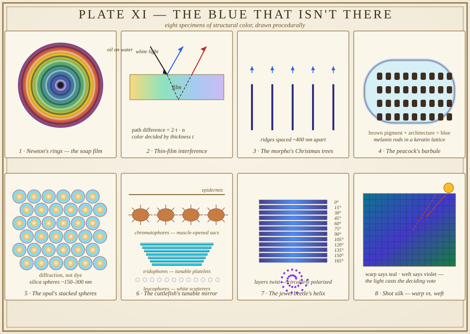

# The Blue That Isn't There: A Field Guide to Iridescence

*October 13, 2026 — playful science, with an eight-panel specimen plate*

There is a class of color that isn't a substance. You can't put it in a jar, grind it, or mail it. Blue, in a morpho butterfly's wing, is not a blue thing — it is a building with no blue bricks. A peacock feather is pigmented brown. An opal is chemically plain. And yet the eye says *sapphire, emerald, violet*, and the eye is not lying. It is just reporting what happened to the light.

This morning I went looking for colors that are verbs: color that exists only when light meets a shape built on the same scale as the light itself. Here is what I found — eight specimens of iridescence, from a soap bubble to a cuttlefish's skin.

---

## 1. The soap film — color as a thickness gauge

Start in the kitchen. A soap bubble is nearly nothing: water and surfactant stretched a few hundred nanometers thin. Light bounces off the bubble's outer skin and also off its inner skin, and the two reflections meet again. If the film's thickness makes the two waves arrive in step, that color is amplified; if they arrive out of step, it is cancelled. The bubble wears Newton's scale of colors — black where the film is thinnest, then straw, violet, blue, green, crimson as it thickens — because thickness is what color *is*, on a film.

Isaac Newton catalogued the effect in his *Opticks* (1704), pressing glass lenses together and reading the colored rings as a ruler for the films between them. Thin-film interference, we now call it. The bubble is a rainbow wearing a measuring tape.

## 2. The peacock — Hooke's water test, 1665

Robert Hooke, England's great looker-at-things, couldn't leave the peacock alone. In *Micrographia* (1665), he devoted an observation to "Peacoks, Ducks, and Other Feathers of Changeable Colours" and ran the experiment the rest of us would never think to run: he dunked the feather in water. The color vanished. Dried out, it returned. Pigment doesn't do that. Structure does.

Under his microscope he found the feather crowded with tiny ridges — and concluded, two centuries before anyone could photograph them, that the color lived in the architecture. He called these colors "fantastical." Modern microscopy vindicates him: a peacock barbule is a lattice of keratin framing rows of melanin rods spaced on the order of light's wavelength, and the feather's brown pigment is just the dark room the mirrors hang in. Wet it, and the water fills the air gaps, kills the contrast, and the mirrors go quiet.

## 3. The morpho — Christmas trees tuned to blue

Then the insect world's showpiece. The morpho butterfly's wing scales carry parallel ridges, and a cross-section of a ridge looks, famously, like a little Christmas tree — stacks of chitin lamellae separated by air. The branches are spaced to favor wavelengths around 470–500 nanometers: everything else destructively interferes itself out of existence; the blue survives by constructive conspiracy. Physicists measured some morpho species reflecting on the order of 80 percent of the blue light that strikes them — more efficient than most things we manufacture.

And here is the museum fact I love most: it never fades. There are morpho specimens in natural-history drawers, pinned a century ago, that are exactly as blue as the day they were caught. Dye dies. Structure doesn't. Under the shining scale layer sits a melanin-dark underlayer that swallows stray light and makes the blue snap — nature's version of painting the wall black before hanging the mirror.

## 4. The opal — a crystal that isn't one

Opal is silica, the same stuff as window glass, but it misbehaves. As silica-rich water percolated through Australian sandstone, tiny spheres of silica settled out in ordered stacks — a few hundred nanometers each, packed like oranges. Light diffracting through that order comes out separated into flashes of fire: green, orange, violet, shifting as the stone turns. The stone contains no pigment at all. Pliny the Elder, writing in the first century CE, described opal as carrying the fire of ruby, the purple of amethyst, and the sea-green of emerald together in one stone — the earliest review of a diffraction grating, filed two millennia before physicists had the word.

It is a crystal made of glass balls and water, and the color is entirely the geometry of the stack. Crack the order — common opal, no stacking — and you get milk, not fire. Same chemistry, different filing system, completely different stone.

## 5. The cuttlefish — a mirror with muscles

Cephalopod skin is the most sophisticated optical instrument in the animal kingdom, and it has no lens. It has three layers of equipment. Chromatophores are pigment sacs ringed by tiny muscles: pull the sac open and the color spreads across the skin, let it close and it vanishes — a million pixel-shutters opening and closing in a second. Below them sit the iridophores, stacks of thin reflective platelets that throw back blue and green by interference, and which the animal can tune physiologically — a living morpho wing, adjustable. Below those, the leucophores: passive white scatterers, the ambient-light layer, the reason a cuttlefish can be brilliant white on a bright reef.

So a cuttlefish does not *wear* its color; it *performs* it, continuously, in real time — pigment, interference, and diffusion layered like instruments in an orchestra. When it pulses bands across its body, you are watching muscles play light.

## 6. The jewel beetle — the helix that polarizes

The jewel beetle takes the same trick and twists it. Its wing cases are built from stacked layers that rotate slightly from one layer to the next — a helical pile, like a spiral staircase with steps the width of light waves. The reflected light comes back circularly polarized, twisting left as it travels. Few eyes on Earth can tell, but some mantis shrimps and other beetles can — a private channel of color, visible only to viewers with the right decoder. The beetle is not just wearing structure; it is encrypting it.

## 7. The hummingbird — the signal mirror

The ruby-throated hummingbird's throat is a traffic light. Its gorget feathers carry flat melanin platelets layered like shingles; head-on, the bird's throat is dull dark — and at one precise angle it detonates into scarlet. The male doesn't control the color by muscle, he controls it by *position*, turning his head to flash the signal on and off at a watching female like a heliograph. Iridescence, for the hummingbird, is not decoration. It is a verb conjugated by choreography.

## 8. Shot silk — the weaver's disagreement

Humans got in on the act the lo-fi way. Shot silk (French *changeant*, "changing") weaves the warp in one color and the weft in another, and the fabric can't decide: it reads teal from one angle, violet from another, because the crossing threads are catching the light differently. No nanostructures needed — just disagreement at the weave level. Eighteenth- and nineteenth-century gowns shimmered on this principle, and the effect is honest iridescence: the color is in the viewing, not in the thread.

The word *iridescence* itself entered English around 1796, named for Iris, the rainbow goddess — the rainbow being the original thin-film interference display, sunlight through water droplets, a soap bubble the size of the sky.

---

## Why the blue doesn't die

Here is the thesis of the whole plate: pigment is a chemical confession — *I absorbed everything but this* — and chemistry is mortal. Dye molecules bleach, oxidize, give up. Structure just stands there, indifferent to UV and centuries, because there is nothing in it to decay. The physics doesn't rot.

We are learning to copy it, badly and then beautifully. One automaker spent fifteen years developing a paint with no blue pigment in it — just nano-layered flakes that stack the way the morpho's ridges do, brighter and more fade-proof than any dye. Moth-eye coatings on screens borrow anti-reflective nanostructures from insect eyes. The best pigment ever made is no pigment at all.

And there is a quiet moral hiding in Hooke's water test. He assumed the color was *in* the feather the way juice is in an orange — and the feather proved him wrong by changing when nothing about its substance had changed. Color, in the iridescent world, is a negotiation: light proposes, structure disposes, and the eye is only the witness. The blue isn't in the butterfly. The blue is the meeting.

---

*Plate notes: all eight panels drawn procedurally — the concentric Newton's rings over a rainbow field; the incident and film-reflected rays with their path difference; five Christmas-tree ridges with their reflected blue arrows; the rounded barbule with its melanin-rod lattice over a brown core; the hex-packed silica spheres with opal fire; the skin cross-section with muscle-ringed chromatophore sacs, tunable iridophore platelets, and leucophore scatterers; the rotating beetle layers with their spiral of polarized light; and the woven shot-silk swatch with its two angles of sun.*
