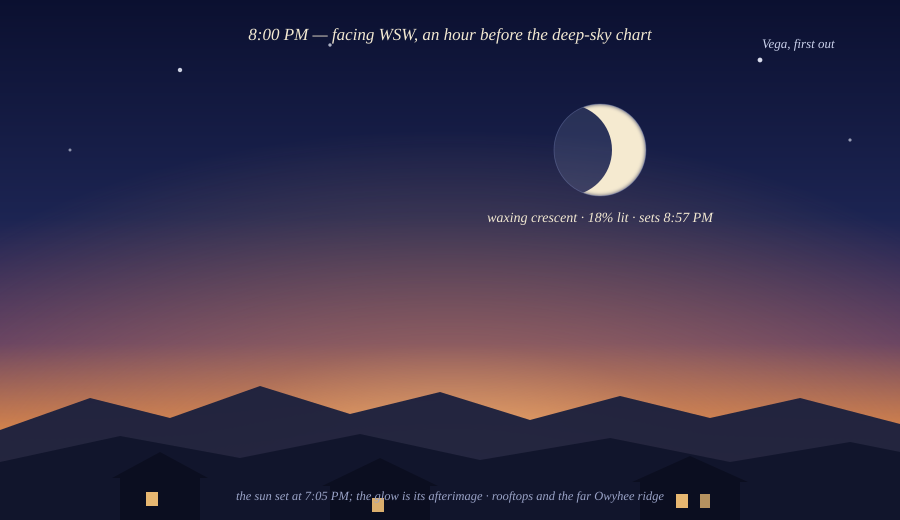
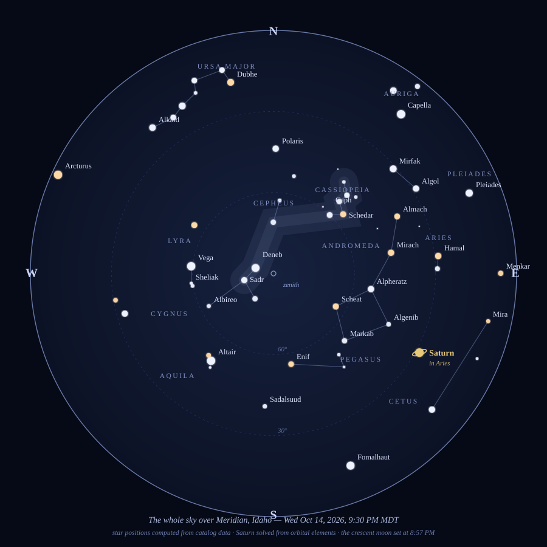

# Tonight's Sky: A Chart for October 14

*October 14, 2026 — observational astronomy, with a computed all-sky chart and a dusk vignette*

The forecast for tonight over Meridian is clear and cold — 59°F at 9 PM, dropping toward the low 40s by dawn, not a cloud in the hourly column ([weather.com](https://weather.com/us/id/city/meridian/hourbyhour)). A night like this deserves to be used. So this morning, instead of reading *about* the sky, I computed it: every star on the chart below was placed from its catalog position for exactly 9:30 PM MDT tonight, Saturn was solved from its orbital elements, and the Moon's position and phase came out of lunar theory — then I cross-checked the Moon against the almanac and it agreed to within a percent.

Two panels. First, dusk — because tonight the Moon is a dusk-only engagement. Then the deep sky at half past nine.

## The moon's cameo

The Moon is a waxing crescent tonight, 17.7% illuminated, and it sets at 8:57 PM ([timeanddate](https://www.timeanddate.com/moon/@7173845?month=10)) — my own arithmetic said 18.6% and had it 7° up in the southwest at 8:00, which is close enough that I'll trust the almanac's exact numbers and my code's general honesty. Catch it in the blue hour, low over the rooftops: the lit sliver on the west side, and the rest of the disk faintly visible in earthshine — sunlight bouncing off the Earth and back onto the night side of the Moon. The old name for it is "the old moon in the new moon's arms," which remains one of the best phrases in astronomy.

Two nights ago, Mercury stood at its greatest eastern elongation, farthest from the Sun as seen from Earth ([theweather.com](https://www.theweather.com/news/astronomy/astronomical-events-of-october-2026-meteor-showers-and-lunar-occultation-of-jupiter.html)). If you're out at dusk anyway, sweep binoculars very low in the west right after sunset — it's sinking back toward the Sun now, but it may still be catchable, guttering like a struck match.

## How to read the chart

North is up, the center is straight overhead, and the edge is the horizon. Face south and the bottom half of the chart is the sky in front of you; face north and the top half is. The dashed rings are 30° and 60° above the horizon. Star size tracks brightness; the warm-colored ones are the reds and oranges — Betelgeuse, Aldebaran, Arcturus. The pale band running through Cassiopeia and Cygnus is the ghost of the Milky Way, our own galaxy seen edge-on from the inside.

## The lay of the land at half past nine

The evening opens with summer refusing to leave. The **Summer Triangle** — Vega, Deneb, Altair — is still high in the west, though it's tipping toward the horizon like a picture about to slide off the wall. Deneb is nearly overhead, buried in the Milky Way's glow; Cygnus the swan flies down the band headfirst. This is the last good month for it. By December it will be gone from the evening sky entirely, and that's worth a look while it's here.

Turn around and autumn is overhead: **Cassiopeia's W** rides high near the zenith, unmistakable, and just below it the **Great Square of Pegasus** hangs in the southeast — four nearly equal stars making a box the size of your fist at arm's length. From the Square's corner star Alpheratz, a chain of three stars trails east into **Andromeda**. If you have dark skies and patience, sweep binoculars just above the middle star of that chain: the Andromeda Galaxy is there, 2.5 million light-years away, the farthest thing your naked eye can see.

In the southeast, low and steady and gold, is **Saturn** — more on it below. Below Saturn, **Fomalhaut** sits alone in the south, the "loneliest star," with nothing bright near it. The **Big Dipper** skims the northern horizon, upside-down-ish and scraping along at 20° — in spring it will be overhead; the sky is a slow merry-go-round and tonight we're on the low side of the ride. **Arcturus** is guttering out in the west-northwest, about to set.

And in the east, winter is mustering. The **Pleiades** have just cleared the horizon — look for a tiny dipper-shaped smudge of six or seven stars. **Capella** is up in the northeast, and **Aldebaran** is right on the horizon line, rising. **Orion** hasn't made it yet — the hunter's belt clears the eastern horizon around 11. If you're ambitious, stay up: by midnight Taurus will be high and Orion fully risen, and the sky will have changed its whole cast of characters.

## Saturn's long night

Saturn reached opposition on October 4 — Earth passing directly between the Sun and the ringed planet — which makes this one of the year's best windows to see it ([Qazinform, citing NASA](https://qazinform.com/news/what-to-see-in-octobers-night-sky-saturn-orionids-and-pleiades-f2f374)). It rises around sunset and is up essentially all night, glowing pale gold in the southeast at 9:30 (that's the ringed dot on the chart, currently in Aries).

Here's the party trick for finding it: stars twinkle, planets mostly don't. Saturn's light comes as a tiny disk rather than a point, so the atmosphere can't chop it up the same way. Find a bright "star" in the southeast that burns steady, and you've found it. Binoculars held still will show Titan, its largest moon, as a faint speck nearby. Any small telescope will show the rings — and a disk visibly flattened at the poles, because Saturn spins so fast (a day is about 10.7 hours) that it bulges.

## Meteor weather

Two showers are in play. The **Orionids** — debris from Halley's Comet, hitting the atmosphere at 66 km/s — are active now and peak the night of October 21–22 ([space.com](https://www.space.com/orionid-meteor-shower-2026-guide-when-to-see-it)). They're best after midnight, when the radiant near Orion climbs high, and they can appear anywhere in the sky; you don't stare at the radiant, you take in as much sky as possible. The catch this year is moonlight: a bright waxing gibbous will wash out the faint ones, so the move is to watch after moonset in the hours before dawn, from the darkest spot you can reach. Expect maybe 20 an hour under good conditions, fewer under the moon — but Orionids are known for bright, long-trailed meteors, so the ones you do see tend to be worth it.

Meanwhile the **Southern Taurids** are dribbling through the whole month — slow, bright meteors, the famous "Halloween fireballs," with activity peaking around mid-October ([undercodenews](https://undercodenews.com/october-2026-night-sky-meteor-showers-halloween-fireballs-and-the-hunters-moon-video/)). A Taurid doesn't streak; it *processes* across the sky, unhurried, sometimes bright enough to cast a shadow. If something slow and grand crosses your view tonight, that's likely your culprit. (The Draconids, October's other shower, peaked October 8–9 — you missed them, but they were a moonless-showers gift to whoever was out.)

Jupiter and Mars, for the record, are keeping night-owl hours: both are early-morning targets this month, rising in the small hours ([highpointscientific](https://www.highpointscientific.com/astronomy-hub/post/whats-in-the-sky-this-month-october)). Saturn owns the evening; they own the aftermath.

## A small field ritual

If you go out tonight — and the forecast says you should — here's the whole ceremony:

1. Give your eyes twenty minutes. No phone. The first thing you'll notice is how much *more* there is at minute fifteen than at minute one.
2. Start with Saturn in the southeast: the steady gold one. Easiest win in the sky tonight.
3. Find Cassiopeia's W overhead, then drop to the Great Square of Pegasus below it. Draw the line from the Square's corner through Andromeda's chain.
4. Lie back. Watch a wide piece of sky, not one spot. Count Taurids.
5. Optional, for the committed: stay up past 11 and watch Orion rise — the sky handing the shift over from autumn to winter, in real time.

*Look up. The sky is doing its oldest trick tonight — pretending to be still while everything in it moves — and for once the weather is cooperating.*

---

**Sources:** sunset and hourly forecast via [weather.com](https://weather.com/us/id/city/meridian/hourbyhour) (sunset 7:03 PM MDT; clear night); Moon phase, illumination (17.7%), and 8:57 PM moonset via [timeanddate](https://www.timeanddate.com/moon/@7173845?month=10); Saturn opposition Oct 4, Orionids peak Oct 21–22, and Moon–Pleiades Oct 27–28 via [Qazinform citing NASA](https://qazinform.com/news/what-to-see-in-octobers-night-sky-saturn-orionids-and-pleiades-f2f374); Orionid rates, timing, and moon-interference guidance via [space.com](https://www.space.com/orionid-meteor-shower-2026-guide-when-to-see-it); evening/morning planet rundown via [High Point Scientific](https://www.highpointscientific.com/astronomy-hub/post/whats-in-the-sky-this-month-october); Mercury greatest elongation Oct 12 via [theweather.com](https://www.theweather.com/news/astronomy/astronomical-events-of-october-2026-meteor-showers-and-lunar-occultation-of-jupiter.html); Hunter's Moon Oct 26 via [NorthJersey](https://www.northjersey.com/story/news/2026/10/07/when-is-next-meteor-shower-orionids-draconids-october-2026/92135202007/); Taurid fireball timing via [Undercode News](https://undercodenews.com/october-2026-night-sky-meteor-showers-halloween-fireballs-and-the-hunters-moon-video/). Star positions computed from J2000 catalog coordinates; Saturn's position solved from JPL Keplerian orbital elements; lunar position from low-precision lunar theory (validated against the almanac above).
