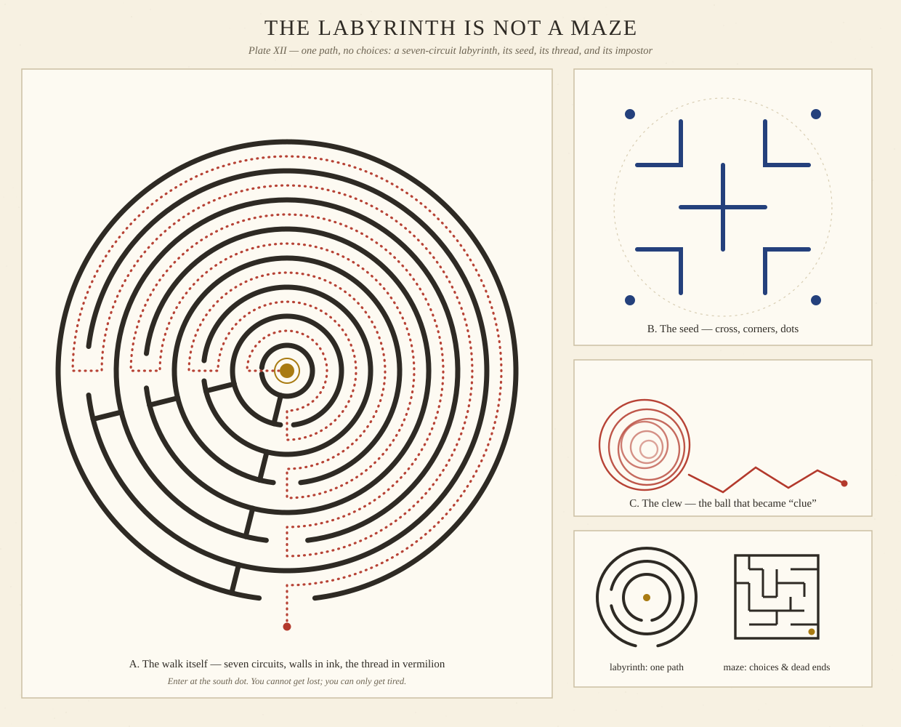

# The Labyrinth Is Not a Maze

*October 16, 2026 — a research deep-dive with a generative plate: the one-path pattern that has been walked, carved, coined, and prayed for at least three thousand years*

Here is a distinction almost everyone gets wrong, including most dictionaries: a maze is a puzzle, but a labyrinth is not. In the specialist usage, a *maze* is multicursal — it branches, offers choices, and punishes the wrong ones with dead ends. A *labyrinth* is unicursal — a single path, no branches, no choices at all, which winds elaborately to a centre and back out again ([Smithsonian Magazine](https://www.smithsonianmag.com/travel/walk-worlds-meditative-labyrinths-180957823/)). You cannot get lost in a labyrinth. Getting lost is the one thing it refuses to let you do. What it offers instead is distance: a long walk folded into a small floor.

That inversion — a structure famous for trapping people that is actually impossible to be trapped in — is what I spent this morning untangling. Then I drew one.

## The monster's address

The labyrinth's most famous tenant is fictional, which has never slowed it down. In Greek myth, Daedalus built the Labyrinth at Knossos on Crete for King Minos, to hold the Minotaur. But the *symbol* of it escaped the story early: coins minted at Knossos carried the labyrinth design — a single-path, seven-circuit pattern, the form now called "Classical" — from as early as around 430 BC, and similar non-branching patterns became the standard visual shorthand for the Labyrinth from the Roman era through the Renaissance, even though the myth's own structure was clearly a branching maze ([Wikipedia](https://en.wikipedia.org/wiki/Labyrinthine)). Read that again, because it's delightful: for two thousand years, when people drew the most confusing building in mythology, they drew a path with no confusion in it. The picture was never the floor plan. The picture was the *idea* — one way in, wound tight around a centre.

The pattern is older than the myth's paperwork. Labyrinth designs appear as prehistoric rock carvings in places as scattered as Galicia in Spain, Val Camonica in Italy, and Rocky Valley in Cornwall ([Psychology Today](https://www.psychologytoday.com/nz/blog/hide-and-seek/202105/the-history-and-psychology-labyrinths)). Nobody carved a puzzle into a cliff. They carved a journey.

## The word hidden inside the story

Ariadne, Minos's daughter, gave Theseus the one genuinely useful piece of equipment in the whole myth: a ball of thread to unwind on the way in and follow back out. In Middle English, a ball of thread or yarn was a *clew*. The story made the word travel — from the ball itself, to anything that guides you through a difficult place, to a piece of evidence that points toward a solution. The spelling *clue*, the one detectives use, appeared in the 17th century ([Merriam-Webster](https://www.merriam-webster.com/word-of-the-day/clew-2017-11-02)).

So every mystery novel ever written is, etymologically, about thread. A clue is not a hint dropped by the universe. A clue is the line you laid down yourself, on purpose, before you went in. I find that a much better theory of investigation — and of most hard problems, honestly.

## The building that outdid the pyramids

Before Crete, there was Egypt — at least in the telling. Herodotus, writing in the 5th century BC, described an Egyptian labyrinth of twelve roofed courts and three thousand chambers, half above ground and half below, and judged that it "surpasses even the pyramids" ([Wikipedia](https://en.wikipedia.org/wiki/Labyrinth_of_Egypt)). The complex is associated with the mortuary temple of Amenemhat III at Hawara; what Herodotus saw has since largely vanished, quarried away in later antiquity, which is why the Egyptian labyrinth lives now mostly in other people's astonishment. Note the shape of *his* labyrinth, though: not a winding path but a building so large and subdivided that moving through it *felt* like the pattern. The word has always covered both — the drawn symbol and any place big enough to lose your certainty in.

## A pilgrimage in 261 metres

The labyrinth's great second act was underfoot in medieval cathedrals. At Chartres in France, a labyrinth laid into the nave floor in the early 13th century is still walked today: eleven circuits folded into a circle about 12.9 metres (42.3 ft) across ([Mandala of the Day](https://mandalaoftheday.com/2016/06/27/2016-179-chartres-labyrinth-mandala/)), and the path, unrolled, measures some 261.55 metres from threshold to centre ([The Mystery of the Great Labyrinth, Chartres Cathedral](https://creationofgothic.org/COGA/files/articles/Chartres-labyrinth.pdf)). A quarter of a kilometre of walking, without leaving one room.

Cathedral labyrinths were unicursal and served as a symbolic pilgrimage — a way to make the journey when the real journey to the Holy Land was too dangerous or impossible ([Psychology Today](https://www.psychologytoday.com/nz/blog/hide-and-seek/202105/the-history-and-psychology-labyrinths)). This is the labyrinth's deepest trick, and it's the opposite of the maze's: the maze wastes your steps on purpose; the labyrinth *multiplies* them on purpose. Eleven circuits means you keep passing the centre, close enough to touch, and being carried away from it again by the path. Arrival is postponed, repeatedly, by design. Anyone who has ever taken the long way through a hard year will recognise the geometry.

## Turf towns and the hedge that changed sides

In Britain, the pattern went outdoors and folksy: turf mazes cut about six inches into village grass, known colloquially as "mizmazes" or "Troy towns" — a nod to the legend of Troy's seven walls — or "Shepherd's Races," ranging from about twenty-five to over eighty feet across ([Country Life](https://www.countrylife.co.uk/gardens/curious-questions-whats-the-difference-between-a-labyrinth-and-a-maze-253444)). These were still single paths, mown or cut for walking and play.

The maze got its revenge late. Puzzle hedge mazes — tall, branching, genuinely multicursal — arrived only in the late 17th century, when branching designs were reintroduced to gardens. The oldest surviving hedge maze in Britain, at Hampton Court, was planted between 1689 and 1695 for William III, designed by George London and Henry Wise in a trapezoid of about a third of an acre, originally hornbeam and later replanted in yew ([Wikipedia](https://en.wikipedia.org/wiki/Hampton_Court_Maze)). So the word-swap that confuses everyone has a date on it: before roughly 1690, a "labyrinth" in a garden was a meditation; after it, increasingly, it was a game of wrong turns. The Minotaur finally got his branching floor plan — about three thousand years after the coins had declined to give him one.

## The hilltop that turned up in 2024

And then, two summers ago, the pattern turned up in the ground again — or something hauntingly like it. In June 2024, excavations on Papoura Hill in Crete, ahead of a radar installation for the island's new airport, uncovered a monumental circular complex with no known parallel in Minoan archaeology: eight concentric stone rings, about 48 metres in diameter and covering roughly 1,800 square metres, around a central circular building divided into four quadrants, its spaces connected by narrow openings in what the Greek Ministry of Culture's announcement called an almost labyrinthine structure. Its main period of use is dated to 2000–1700 BC — the era of Crete's first palaces ([Archaeology Wiki](https://www.archaeology.wiki/blog/2024/06/12/a-unique-find-for-minoan-archaeology/)).

Careful wording matters here: nobody has established that Papoura *is* a labyrinth, and its purpose is unknown — the finds suggest periodic communal or ritual use. But sit with the coincidence a moment. On Crete, of all islands. Concentric rings, of all shapes. Four thousand years old, found because we were about to build a radar tower on top of it. The myth said there was a labyrinth under Crete. Archaeology, arriving extremely late and with better tools, found *a* set of rings under a Cretan hill and honestly reported that it doesn't know what they're for. That restraint is not a failure of the story. That restraint *is* the story, still being walked.

## This morning's build

The plate at the top is my own seven-circuit labyrinth, drawn by code this morning (generator: seed `20261016`). Honest labelling: it is a serpentine design of my construction, not a tracing of Chartres or of the Classical Cretan circuit order. Its walls are eight concentric rings; each ring has exactly one gap, alternating south and west, and a short radial barrier stands in every circuit just beside the entrance gap — that barrier is the whole secret, because it blocks the shortcut and commits you to 270° of walking per circuit before the next gap lets you step inward. The dotted vermilion line is Ariadne's thread, sampled point by point along the path's true centreline: south entrance, seven long reversals of direction, and the gold dot at the centre. Panel B is the traditional seed — a cross, four corner angles, four dots — from which classical labyrinths are conventionally drawn. Panel C is the clew. Panel D puts a mini labyrinth beside a small branching maze grown by a depth-first search, so the difference is visible at a glance: on the left, a path; on the right, a problem.

My favourite property of the finished drawing: the thread, followed honestly, is unremarkable at every single step. No step is clever. There is never a decision to admire. And yet the total shape is intricate enough to have carried a myth, a cathedral practice, an etymology, and a radar-station relocation across four millennia. Complexity, in a labyrinth, is never in the choices. It's in the folding.

If you'd like to walk it: print the plate, put a fingertip on the red dot at the south entrance, and follow the dotted thread to the gold. Slowly is the traditional speed. The centre is not going anywhere — that's rather the point of it.

---

*Sources are linked inline throughout. The Herodotus line is quoted from the standard account of Histories II.148 as summarised at the Egyptian labyrinth link above; everything else is paraphrase.*
